# 🪂 SKYFALL: THE LAST DESCENT

<div align="center">


**A complete 3D free-fall adventure for the desktop browser.**

*7,000 m. 14 km. 10 stages. One descent.*

[🚀 Run It](#-run-it) • [🎮 Controls](#-controls) • [🎯 How to Play](#-how-to-play) • [🏗️ Architecture](#-architecture) • [🔧 Customizing](#-customising)

</div>

---

## 📖 Overview

**SKYFALL: THE LAST DESCENT** is a **complete 3D free-fall adventure** for the desktop browser.

You start on a **summit at 7,000 m**, jump into the sky, and descend through **ten stages** — **across a full dynamic day/night cycle** — until you land.

### Core Idea

> **Everything is procedural.**
>
> **Terrain, water, sky, clouds, wildlife, avatar, and audio** *(Web Audio)* — **no external assets required**.

### The Descent

```mermaid
flowchart LR
    Summit["🏔️ Summit<br/>7,000 m"] --> S1["❄️ Snow Peaks"]
    S1 --> S2["☁️ Clouds"]
    S2 --> S3["💧 Waterfalls"]
    S3 --> S4["🏞️ Valleys"]
    S4 --> S5["🏜️ Canyons"]
    S5 --> S6["⚡ Lightning Storm"]
    S6 --> S7["🧊 Frozen Kingdom"]
    S7 --> S8["🌑 Dark Descent"]
    S8 --> S9["⛰️ Last Mountain"]
    S9 --> S10["🌅 Golden Paradise"]
    S10 --> Land["🎯 Land<br/><em>below 28 m/s</em>"]

    style Summit fill:#61DAFB,color:#000
    style S1 fill:#E0F2FE,color:#000
    style S2 fill:#94A3B8,color:#fff
    style S3 fill:#0EA5E9,color:#fff
    style S4 fill:#22C55E,color:#fff
    style S5 fill:#FFB454,color:#000
    style S6 fill:#8B5CF6,color:#fff
    style S7 fill:#BAE6FD,color:#000
    style S8 fill:#0f172a,color:#fff
    style S9 fill:#475569,color:#fff
    style S10 fill:#FFD700,color:#000
    style Land fill:#4CAF50,color:#fff
```



---

## 🚀 Run It

### Requirements

- **Node.js 18+**
- A modern **desktop browser with WebGL2** — Chrome, Edge, Firefox, Safari

### Development

```bash
npm install
npm run dev        # http://localhost:5173
```

### Production Build

```bash
npm run build
npm run preview
```

### Optional — Type Check

```bash
npm run typecheck
```

---

## 🎮 Controls

<div align="center">

| Key | Action |
|:---:|--------|
| **SPACE** | **Jump** from the ledge · then **toggle glide** |
| **W** | **Dive** *(fastest fall)* |
| **S** | **Air brake** *(slow, stable — use it to land)* |
| **A / D** | **Steer** left / right |
| **SHIFT** | **Boost** *(drains the boost bar)* |
| **C** | **Camera** — chase / first-person / wide |
| **Mouse** | **Click the game** to capture the mouse — **move to steer** |
| **ESC / P** | **Pause** |

</div>

### 🎮 Gamepad

<div align="center">

| Input | Action |
|:-----:|--------|
| **Left stick** | Steer / dive / brake |
| **A** | Jump / glide |
| **RB / RT** | Boost |
| **Y** | Camera |
| **Start** | Pause |

</div>

---

## 🎯 How to Play

### ✈️ The Basics

- **Glide (SPACE)** to stay near the **glowing guide rings**
- **Free fall and dive** to lose height quickly
- **Total descent:** **7,000 m** over **14 km**

### 🟡 Checkpoints

> **Fly through the AMBER CHECKPOINT RINGS at the end of each stage.**
>
> **Crash and you restart from the last one you banked.**

### 💥 Hazards

<div align="center">

| Type | Effect |
|:----:|--------|
| **Lethal** | **Spires · boulders · cave walls · trees · canyon walls · the ground** |
| **Hurts only** *(speed loss, score loss)* | **Birds · falling rocks · lightning** |

</div>

### 🌬️ Wind and Weather

<div align="center">

| Effect | Behavior |
|:------:|----------|
| **Updraft columns** | **Lift you** |
| **Wind tunnels** | **Shove you sideways** |
| **Storm and snow cells** | **Buffet you** |

</div>

### 🏁 Landing

> **In stage 10 you can land anywhere.**
>
> **Touch down below 28 m/s vertical speed** — **air brake!**
>
> **The golden beacon marks the meadow beside the river.**

### 🎮 Modes

<div align="center">

| Mode | Description |
|:----:|-------------|
| **Adventure** | **10 stages** · checkpoints · scoring |
| **Endless Fall** | **Looping canyon** · winds strengthen each lap · **best depth saved** |
| **Time Trial** | Race the clock |
| **Exploration** | **No crashes** · weather and time-of-day controls in the pause menu |
| **Challenge** | **5 hand-made objective routes** |

</div>

---

## 🏗️ Architecture

### System Overview

```mermaid
flowchart TB
    subgraph UI["🖥️ UI Layer"]
        Components["components/<br/>ui · hud · menus · loading<br/><em>React + Tailwind</em>"]
        Zustand["stores/<br/>Zustand UI store"]
    end

    subgraph CORE["⚙️ Game Core"]
        Game["Game<br/>orchestrator"]
        Loop["GameLoop"]
        State["GameState"]
    end

    subgraph PLAYER["🪂 Player"]
        Physics["PlayerPhysics<br/><em>aerodynamic model</em>"]
        Controller["PlayerController"]
        Animation["PlayerAnimation"]
        Camera["PlayerCamera"]
        Player["Player"]
    end

    subgraph WORLD["🌍 World"]
        Mountain["MountainGenerator<br/><em>analytic world</em>"]
        Terrain["Terrain<br/><em>2-ring mesh</em>"]
        River["River"]
        Waterfall["Waterfall"]
        Forest["Forest"]
        Clouds["Clouds"]
        Wildlife["Wildlife"]
        World["World"]
    end

    subgraph ENV["🌦️ Environment"]
        DayNight["DayNightCycle"]
        Sky["SkyDome"]
        Lighting["LightingSystem"]
        Fog["FogSystem"]
        Weather["WeatherSystem"]
        Wind["WindSystem"]
        Precip["Precipitation"]
        ScreenFX["ScreenEffects"]
    end

    subgraph LEVELS["🗺️ Levels"]
        LevelMgr["LevelManager"]
        L01_10["Level01 … Level10"]
        Challenges["ChallengeDefs"]
    end

    subgraph GAMEPLAY["🎯 Gameplay"]
        Obstacles["ObstacleManager"]
        Collisions["CollisionSystem"]
        Checkpoints["CheckpointSystem"]
        Progress["ProgressManager"]
        Scoring["ScoringSystem"]
    end

    subgraph AUDIO["🔊 Audio"]
        AudioMgr["AudioManager<br/>buses · music · SFX"]
        EnvAudio["EnvironmentAudio<br/><em>adaptive layers</em>"]
    end

    subgraph SYSTEMS["🛠️ Systems"]
        Assets["AssetManager"]
        Perf["PerformanceManager"]
        Input["InputManager"]
        Save["SaveManager"]
    end

    UI --> CORE
    CORE --> PLAYER
    PLAYER --> WORLD
    WORLD --> ENV
    ENV --> LEVELS
    LEVELS --> GAMEPLAY
    GAMEPLAY --> AUDIO
    SYSTEMS --> CORE

    style UI fill:#61DAFB,color:#000
    style CORE fill:#8B5CF6,color:#fff
    style PLAYER fill:#FF6B6B,color:#fff
    style WORLD fill:#22C55E,color:#fff
    style ENV fill:#0EA5E9,color:#fff
    style LEVELS fill:#FFB454,color:#000
    style GAMEPLAY fill:#FFD700,color:#000
    style AUDIO fill:#FF3F9E,color:#fff
    style SYSTEMS fill:#0f3460,color:#fff
```



### 🎯 Key Design Points

> 📖 **See `GAME_DESIGN.md` for details.**

<div align="center">

| Principle | Implementation |
|:---------:|---------------|
| **🌍 One analytic world** | **`MountainGenerator.heightAt(x, z)`** defines the whole world — **terrain mesh, collision, rivers, waterfalls, obstacles, checkpoints, and trees ALL derive from it** — **so they always agree** |
| **✈️ Real aerodynamic model** | **Quadratic drag** *(`a = cd·|v|·v`)* gives **terminal velocities** · **lift** *(`cl·|v|²`)* **perpendicular to the airflow** **converts height into forward speed while gliding** |
| **🎛️ Smooth coefficient blending** | Coefficients blend smoothly between **Free Fall ~210 km/h**, **Dive ~375 km/h**, **Glide ≈3:1 glide ratio**, and **Air Brake ~85 km/h** |
| **🎨 Plain Three.js rendering** | **Two nested terrain meshes** follow the player · **instanced forests** · **custom shaders** for sky, water, waterfalls, and flapping birds · **camera-relative particle fields** for rain, snow, leaves, and speed lines |
| **⚡ Adaptive quality** | **Low / Medium / High / Ultra** presets · **optional adaptive scaling** that **lowers quality if FPS stays under ~38** |
| **💾 Local persistence** | **Checkpoints** *(Adventure)*, **best results**, **completed challenges**, and **settings** stored in `localStorage` |

</div>

### 🎯 Why Vanilla Three.js Instead of React Three Fiber + Rapier?

> **The brief recommended React Three Fiber and Rapier. This project uses vanilla Three.js with a hand-written aerodynamic model instead.**

<div align="center">

| Decision | Reason |
|:--------:|--------|
| **No rigid-body engine** | **A falling body with lift/drag needs no rigid-body engine** |
| **Analytic collision** | **Cylinders, spheres, tunnels, heightfield** — **cheaper and more predictable** than a physics solver |
| **React only for UI** | **React is used for all menus and HUD** · **Zustand holds UI state** |
| **Procedural avatar** | **Low-poly wingsuit jumper** — **no model files** |
| **No texture compression** | **Not applicable because there are no image textures** |

</div>

---

## 🔧 Customizing

### 🗺️ Add or Retune a Stage

**Edit `src/game/levels/LevelNN.ts`:**

- Weather
- Biome
- Obstacle counts
- Wildlife
- Hours of day

### 🎯 Add a Challenge

**Append to `src/game/levels/ChallengeDefs.ts`.**

### 🎨 Replace the Procedural Content

**Drop your own audio or models into `public/`** — **and load them from `AssetManager`.**

> 💡 **Texture compression is not applicable** because there are **no image textures**.

---

## 🎛️ Tuning

> **The three knobs that shape the game's feel.**

<div align="center">

| What to Tune | Where |
|:------------:|-------|
| **Aerodynamics** | **`AERO` table** at the top of `PlayerPhysics.ts` |
| **Terrain shape** | **`MountainGenerator.ts`** |
| **Per-stage weather, biome, and content** | **`Level*.ts`** files |

</div>

---

## 🗺️ Roadmap

### ✅ Current

- [x] React + TypeScript + Vite foundation
- [x] Vanilla Three.js rendering with WebGL2
- [x] Procedural terrain, water, sky, clouds, wildlife, and avatar
- [x] Synthesized Web Audio — no audio files
- [x] **Zero external assets required**
- [x] **7,000 m descent over 14 km**
- [x] **10 stages** — snow peaks, clouds, waterfalls, valleys, canyons, lightning storm, frozen kingdom, dark descent, last mountain, golden paradise
- [x] **Full dynamic day/night cycle** across the descent
- [x] **Analytic world** via `MountainGenerator.heightAt(x, z)` shared by terrain, collision, rivers, waterfalls, obstacles, checkpoints, and trees
- [x] **Aerodynamic physics** with quadratic drag and lift
- [x] **Smooth blending** between free fall, dive, glide, and air brake
- [x] **Five modes** — Adventure, Endless Fall, Time Trial, Exploration, Challenge
- [x] **Endless Fall** with strengthening winds and best-depth saving
- [x] **Exploration mode** with no crashes and weather/time-of-day controls
- [x] **Five challenge routes** with objectives
- [x] **Amber checkpoint rings** with crash-respawn to last banked checkpoint
- [x] **Lethal hazards** — spires, boulders, cave walls, trees, canyon walls, ground
- [x] **Non-lethal hazards** — birds, falling rocks, lightning
- [x] **Updraft columns** that lift you
- [x] **Wind tunnels** that shove you sideways
- [x] **Storm and snow cells** that buffet you
- [x] **Landing mechanic** requiring vertical speed below 28 m/s
- [x] **Golden landing beacon** marking the target meadow
- [x] **Three camera modes** — chase, first-person, wide
- [x] **Keyboard, mouse, and gamepad** input
- [x] **Boost bar** with SHIFT
- [x] **Procedural low-poly wingsuit avatar**
- [x] **Two nested terrain meshes** following the player
- [x] **Instanced forests**
- [x] **Custom shaders** for sky, water, waterfalls, and flapping birds
- [x] **Camera-relative particle fields** for rain, snow, leaves, and speed lines
- [x] **Adaptive quality** with optional FPS-based scaling
- [x] **Four graphics presets** — Low, Medium, High, Ultra
- [x] **LocalStorage persistence** for checkpoints, best results, completed challenges, and settings
- [x] **Zustand UI store** separate from game state
- [x] **React + Tailwind UI** for menus, HUD, settings, and results
- [x] **`GAME_DESIGN.md`** with detailed design notes
- [x] **Documented deviations** from the original brief with reasoning

### 🔜 Future Ideas

- [ ] **Additional stages** beyond the current 10
- [ ] **Additional challenge routes** beyond the current 5
- [ ] **Additional modes** — e.g. multiplayer race
- [ ] **Real audio and models** as optional drop-in replacements for procedural content
- [ ] **Photo mode** — for shareable captures
- [ ] **Replay system** — review your best descents
- [ ] **Local leaderboards** — per mode, per stage
- [ ] **Achievements** — for milestones and rare landings
- [ ] **PWA support** — install and play offline
- [ ] **Localization** — bilingual UI

---

## 🤝 Contributing

Contributions are welcome. Please:

1. Fork the repository
2. **Keep the analytic world as the single source of truth** — everything must derive from `MountainGenerator.heightAt(x, z)`
3. **Keep physics hand-written** — drag and lift are the model, not a rigid-body engine
4. **Keep it fully procedural** — no required external assets
5. **Keep React for UI only** — game logic must not live in React components
6. **Keep tuning centralized** — the `AERO` table, `MountainGenerator.ts`, and `Level*.ts`
7. **Preserve localStorage compatibility** without a migration path
8. **Update `GAME_DESIGN.md`** when changing design decisions
9. **Test in a WebGL2-capable desktop browser**
10. Submit a Pull Request

### Guidelines

- **Never couple collision to rendering** — both must derive from the same analytic world
- **Never add a required external asset** — procedural is the default
- **Never break the checkpoints** — crash-respawn is core
- **Never bypass the landing speed check** — it's the game's final skill test
- **Never present a stub as a feature**

---

## 📜 License

MIT — see [LICENSE](LICENSE) for details.

---

## 🙏 Acknowledgments

- **Three.js** — for making a procedural 3D world this immersive without assets
- **Web Audio API** — for a game with zero audio files
- **Every skydiver who's ever looked down and felt the drop** — this one's for you

---

<div align="center">

### 🪂 JUMP. DIVE. GLIDE. LAND.

**A complete 3D free-fall adventure for the desktop browser.**

**7,000 m. 14 km. 10 stages. Zero external assets.**

<br>

> 🏁 **Land below 28 m/s — the golden beacon marks the meadow.**

<br>

⭐ If SKYFALL took your breath away, consider giving it a star.

<br>

[⬆ Back to Top](#️-skyfall-the-last-descent)

</div>
